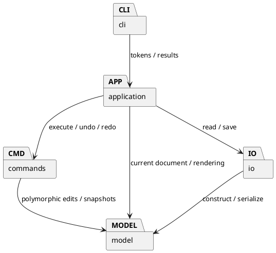

# Lab1 Phase 1：架构设计与协作记录

我依据 [作业原文](phase_cli_1.md) 整理 [验收清单](REQUIREMENTS.md)，分阶段实现 SVG 编辑器 CLI。项目通过封装、类层次、多态、Composite 与 Command，统一处理图形编辑、文件读写和操作历史。

本阶段内置 rect、circle、ellipse、line、text、g 六种类型。box 的实现安排在原文 4.4 规定的后续插件阶段；当前 `create box` 输出约定的 unknown shape type 错误。

## 架构方案

### 1. 模块划分与职责

| 目录 | 主要类 | 职责 |
|---|---|---|
| src/model/ | Shape、Rect、Circle、Ellipse、Line、Text、Group、Document、ShapeFactory | 封装几何属性、样式、图形行为、父子关系、唯一 id 与同级顺序 |
| src/commands/ | Command、History、各具体 Command 子类 | 执行可撤销编辑，保存前后状态，管理 undo/redo 和 I/O 屏障 |
| src/application/ | Editor、Renderer | 调度命令，协调文档与文件服务，生成反馈、tree、show 和 help |
| src/io/ | SvgCodec、FileStore | 解析和序列化 SVG，补全 id，读写文件并保存覆盖前备份 |
| src/cli/ | Main、Tokenizer | 读取逐行输入，解析注释与双引号参数，显示提示符和执行结果 |
| test/ | 内核、历史、CLI、SVG、架构和原文回放测试 | 验证功能、边界和架构约束 |

examples/ 保存可回放的命令和 SVG 示例；doc/ 保存方案、过程记录和验收材料；work/ 保存本地验证工件。生产代码采用一类一文件，文件名与类名一致。



### 2. 设计模式的选择与落地

**类层次和多态。** Shape 是抽象基类，保存私有的 id、几何属性、样式和导入属性。六种具体类型继承 Shape。Rect.move 操作 x/y，Circle.move 操作 cx/cy，Line.move 操作两端坐标，Text.move 操作文本位置。调用方统一使用 Shape.move。属性和 children 的读取接口提供副本，字段修改通过实体方法完成。

**Composite。** Group 继承 Shape，内部保存 Shape 子节点。Group.move 和 Group.scale 递归调用子节点同名方法；Document 删除容器时移除整个子树。set 对 g 和叶子都提供公共样式操作，g 的样式采用 SVG 继承语义。各类型的几何属性遵循原文白名单。

**Command。** Command 定义 execute、undo、redo。CreateCommand、DeleteCommand、MoveCommand、ScaleCommand、SetCommand、GroupCommand、UngroupCommand、AddToCommand、ReorderCommand 各自封装一种编辑。front/back 通过方向参数复用 ReorderCommand。

以移动为例：

```text
Main -> Tokenizer -> Editor
     -> History.execute(MoveCommand, currentDocument)
     -> Command.execute: 创建候选文档
     -> MoveCommand.apply: document.find(id).move(dx, dy)
     -> 提交成功结果、记录 Command、清空 redo
```

我选择让 Command 记录可撤销操作，再调用多态 Shape.move。CLI 负责理解输入；Command 负责编辑单元和历史；各图形负责自身的几何变化。这个划分对应了我们讨论过的“统一接口、方便调用、方便 undo”的目标。

**Memento 辅助 Command。** 每条成功命令保存编辑前后的 Document 深拷贝。undo/redo 直接恢复快照，精确恢复浮点值、父子关系和顺序；group 的全部结构变化组成一个 undo 单元。每个具体 Command 的 apply 方法仍负责执行实际业务操作。

我接受快照在当前作业规模下的时间与空间成本。历史空间随文档大小和命令数量增长，查找、校验与克隆包含重复遍历。大文档阶段可以引入 id 索引和差量命令。

**事务式提交。** 编辑先作用于候选文档，成功后更新当前文档与历史。read 完成解析和验证后提交文档及路径；canvas 修改通过候选副本验证；save 写成功后更新默认路径。失败时，原文档、默认路径和操作历史保持原值。

**历史屏障。** init、read、save、canvas 修改成功后清空历史并设置屏障，undo/redo 输出 `error: undo not allowed after io command`。下一次成功编辑解除屏障。tree、show、help、canvas 查询保留现有历史，失败命令同样保留历史与屏障状态。

**集中工厂与分派入口。** 名字分派集中在两处：Editor 的命令注册表，以及 ShapeFactory 的类型构造表。CLI 创建和 SVG 读入共用图形工厂。我把这两处标为后续插件阶段的待重构点，届时可接入命令扩展和 ShapeProvider。SvgCodec 将 transform 语法解析为数值操作，再调用图形的多态方法。

### 3. 依赖方向规则

| 来源模块 | 允许依赖 | 理由 |
|---|---|---|
| model | model | 核心实体独立表达图形与树结构规则 |
| commands | commands、model | 可撤销操作围绕实体执行 |
| io | io、model、文件/XML 库 | 文件和格式适配集中在边界 |
| application | application、commands、model、io | 应用层协调编辑、文档和存储 |
| cli | cli、application、Node 输入输出 | 输入通道通过应用层完成操作 |
| test | 所有业务模块与测试工具 | 对行为和依赖关系进行验证 |

同模块依赖用于内部协作。跨模块依赖按图中箭头和表格执行；规则之外的依赖列入架构待处理项。第三方生产依赖集中在 io，终端输入输出集中在 cli。

### 4. 变化点假设

| 预期变化 | 当前扩展位置 | 当前实现边界与理由 |
|---|---|---|
| 新图形与 box | Shape 子类、ShapeFactory 构造入口 | 本阶段完成六类内置图形；插件生命周期按后续阶段要求推进 |
| 新编辑命令 | Command 子类、Editor 注册入口 | 按当前命令集合组织实现，保持编辑单元清晰 |
| 鼠标或 agent 输入 | Editor 与 Command 可复用，Main/Tokenizer 适配输入 | 当前交付 CLI，后续通道复用应用层 |
| 新存储格式 | SvgCodec 与 FileStore 分离 | 当前采用 SVG，出现第二种格式后再提炼公共 Codec 接口 |
| 大文档与长历史 | History、Command、Document 的集中接口 | 当前采用快照和遍历，后续根据性能测量优化 |
| 展示格式调整 | Renderer 集中生成 tree/show | 展示变化集中在应用层 |

## 过程记录

我与 AI 共同讨论需求、设计和修订。以下内容依据真实对话、代码变化与实际运行反馈整理；测试由协作智能体执行，关键结果保存在验证材料中。

### 1. 统一接口与撤销职责

我提出“统一接口？方便调用？方便 undo 操作等等？”，并要求满足文档、分批提交以及保留思考记录。讨论后我将两个目标分开：多态提供统一行为接口，Command 保存一次可撤销操作。最终调用关系采用 MoveCommand -> Shape.move。直接修改 r1.x 的方案会让 CLI 同时承担图形字段知识和历史记录，因此我选择当前的职责划分。

### 2. 逐条确认阶段边界

我要求以上传原文为准。重新阅读后，我把 box 归入后续插件阶段，把根级 g 的 ungroup 错误、save 后的历史屏障加入验收。跨父 group 的插入位置、空历史反馈等细节整理为显式设计决策，保存在验收清单中。

### 3. 通过测试选择历史方案

内核阶段先验证类层次、容器递归和顺序，再实现 Command。测试验证了小数移动后的原值恢复、分组单步撤销和失败编辑保留 redo。我据此保留快照方案，并在架构方案中记录内存和遍历成本。

### 4. XML 转义的修订

含 &、引号、中文和首尾空格的读写往返测试暴露了库默认属性序列化的转义遗漏。我让 AI 检查输出和库实现，改由 SvgCodec 统一转义输出，xml-js 负责结构解析。回归样例包含字面量 &amp;，用于验证文本内容保持原样。

### 5. XML 输入结束校验的修订

集成测试发现 `<svg><rect` 被接受为空文档。检查库实现后，补充了 SAX 的显式抛错回调和 write/close 完整校验。回归验证了失败 read 后文档、默认路径和 redo 保持原值。同轮引号测试的失败来自测试字符串丢失反斜线，改用 String.raw 后得到预期结果。

### 6. 用代码检查架构约束

我把 Main 入口整理为同名类，统一代码格式，并增加 TypeScript AST 检查，遍历生产代码的依赖、类名和字段可见性。读取额外表现属性与 CLI set 白名单分别管理，font-size 和 text-anchor 随克隆、保存和读回保留。

### 7. 文件保护与推送核验

我要求保留本地文件和系统文件。测试工件保存在 work/，save 覆盖前建立唯一 .bak，失败 .tmp 保留供检查。delete 命令处理内存中的 SVG 子树，可通过 undo 恢复。

项目通过真实分步提交形成开发记录。我在 GitHub Desktop 创建仓库并上传，AI 核对 origin/main 和 push reflog。首次查看 final 页面出现 Ref is invalid，随后在当前仓库启用 push.followTags，再通过 Desktop 推送。最终截图确认远端 final 指向 b0bc7a0，并包含当时的七次提交。

### 8. 再次复查与原文回放

我要求在 VS Code 验证运行，并把 README 改为直接陈述。复查发现 PlantUML 标签的换行需要整理、部分提交状态需要更新，以及 SVG 变换规范化需要同步处理字号与线宽。修订后，嵌套 scale 同时保留原示例的几何和数值表现属性；CLI 的 scale 仍按原文几何属性规则执行。

我还按 `group <newGid> <id1> <id2>…` 的语法收紧成员数量，新增失败保持历史的测试。Specification.test.ts 直接从上传 Markdown 提取第 6 节的 19 条命令、第 6.1 A 节的 14 条命令以及背景 SVG，逐条回放并核对输出和保存结果。树输出比较归一化排版空格，并允许额外的线条 stroke 摘要。

本轮修订以新增提交保留。此前发布的 final 作为已核验版本保留，修订版的提交与标签状态在复查报告中单独记录。

## 一致性自查

### 1. 实际目录与方案的对应

实际业务目录为 model、commands、application、io、cli，与方案一致。test、examples、doc、work 分别承担验证、示例、文档和本地工件职责。

Main 的类封装、导入属性的保存、快照历史、文件保留和原文回放测试等修订均已记入过程记录。

### 2. 依赖方向检查结果

Architecture.test.ts 使用 TypeScript AST 检查全部生产 import，并按依赖表逐项验证。本轮检查通过，架构待处理项为两处已声明的分派入口在后续阶段的插件化重构。

代码抽样对应如下：

- MoveCommand 通过 Document 和 Shape 的行为接口执行移动。
- Document 依赖 Shape、Group，负责树结构和唯一 id。
- SvgCodec 依赖 model、xml-js、sax，负责格式适配。
- Main 通过 Editor 协调操作，负责终端边界。

## 质量保证手段

### 1. 功能和边界验证

| 维度 | 验证方式 |
|---|---|
| 命令语法、错误与反馈 | Editor.test.ts 覆盖各类命令、精确错误、数值和参数边界 |
| OOP 与 Composite | Model.test.ts 验证六种图形、多态移动、递归缩放、深克隆和树结构 |
| Command 与 undo/redo | History.test.ts 和 Editor.test.ts 验证单命令粒度、结构恢复、分支和历史屏障 |
| SVG 读写 | SvgCodec.test.ts 验证嵌套、id 补全、冲突避让、XML 转义、文本和表现属性 |
| 原文案例 | Specification.test.ts 直接提取并执行上传文件中的会话和背景 SVG |
| 文件保护 | 验证失败保留原文件、覆盖前备份字节一致、测试工件保留 |
| 实际 CLI 入口 | Cli.test.ts 启动 Node 子进程，验证提示符、脚本、错误和 EOF |
| 架构与静态质量 | AST 依赖/封装检查、严格 TypeScript 检查、统一格式检查 |
| 文档与操作验收 | 文档结构和表述检查，以及 VS Code 终端与浏览器的人工验收步骤 |

具体运行输出见 [本轮复查报告](REVIEW.md) 和历史 [验证记录](VERIFICATION.md)。我的验收依据包括可追踪的需求、自动测试、实际会话输出和 SVG 预览。

### 2. 运行与验证方法

项目使用 Node.js 24+ 直接执行可擦除类型语法的 TypeScript。类型检查由独立的 check 脚本完成。可在 VS Code 的项目终端依次执行：

```sh
node -v
npm -v
npm run check
npm run format:check
npm test
npm run cli
```

首次安装依赖使用 `npm install`。完整的操作步骤、期望输出和故障定位见 [运行验收指南](RUNNING.md)。

### 3. 支持范围与后续改进

- SVG 实现范围覆盖六种内置图形、嵌套 g、数值几何属性、XML 转义和约定的文件读写。根宽高缺省为 800×600，viewBox 支持与画布一致的 `0 0 w h`。
- SVG 的 translate 和正数等比 scale 读入时规范化到几何坐标；数值字号与线宽同步规范化。相对字体单位、完整 CSS 和复杂 SVG 渲染上下文留作扩展；未知图形和当前范围之外的变换返回错误。
- CLI scale 依据原文只缩放各类几何白名单中的位置与尺寸；导入字号和 stroke-width 保持显式属性值。
- tree 使用动态列宽展示 Unicode 树和关键几何属性。
- 快照历史的容量和大文档性能列为后续优化方向。
- 备份和测试工件持续保留，使用者自行管理磁盘空间。
- 作业截止日期为 2026-10-31，具体时刻以课程提交系统为准。分步提交、远端推送和最终标签根据实际记录核对。
