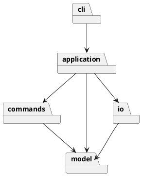

# 架构方案与开发记录

## 模块职责

- model：Shape 抽象、六类实体与 Document；封装几何、树归属、唯一 id、移动和缩放。
- commands：Command 抽象、编辑命令、History；一次成功编辑一个撤销单元。
- application：Editor 应用协调、命令注册、输入校验与输出摘要。
- io：SvgCodec 与 FileStore；XML 和文件系统隔离。
- cli：Tokenizer 与 Main；输入输出及提示符，不直接修改实体。

依赖只能沿上述箭头；model 不认识 CLI、Command、文件系统；commands 不接触 IO；io 不依赖 application。测试可以访问所有层。命令注册表与图形工厂是仅有的两处名字分派，列为后续插件阶段待重构点；暂不实现插件加载。Shape 子类自行描述几何与位置，多态 move/scale/set，无业务 switch(tag)。

## Command 落地

编辑操作经 EditCommand.execute 调用 Document 与多态 Shape；History 保存成功命令、undo/redo 两栈及 I/O 屏障。命令保存编辑前后文档快照（Memento 辅助 Command），undo/redo 原样还原结构、顺序和属性，避免逆向浮点运算损失。代价是每条命令 O(n) 内存，适合作业规模；未来可改差量命令。失败操作在独立文档副本执行，成功后提交，确保原子性。不是只把 CLI 属性赋值包装成名称。

## 变化点

- 新图形：增加 Shape 子类与工厂注册；未来 ShapeProvider 替换内置注册。
- 新输入通道：复用 Editor/Command，CLI 只做输入适配。
- 新序列化：独立 Codec，不让 model 依赖 XML。
- 大文档：快照历史改差量命令；本阶段不提前实现。
- 复合领域图形 box：后续插件阶段，当前明确拒绝创建。

## 过程记录

- 用户：统一接口，方便调用，方便 undo？要求完全满足文档、分步提交、记录共同思考。
- 讨论：为什么不直接在 CLI 里修改 r1.x？直接修改会绕过历史管理，又使 CLI 必须了解 rect/circle/g 各自字段。Command 记录可撤销操作并调用 Shape.move；Rect 移动 x/y，Circle 移动 cx/cy，Group 递归移动子节点。统一调用与撤销职责分别由多态与 Command 承担。
- 纠偏：box 并非本阶段必做，严格按 4.4 阶段边界拒绝；根级 g 不允许 ungroup，不能套用通常绘图软件规则。
- 原文例子包含 transform，但未列完整 XML 支持集：记录受支持变换与拒绝边界，不静默忽略。
- 待实现后补充真实检查结果与修订。

## 一致性自查与质量保证

完成实现后补充目录、依赖抽查、测试数量及实际运行结果。远程仓库与截止时间尚未提供，当前不声称已推送、不声称 final 截止合规。

### 阶段 2：内核

实现 Shape + Rect/Circle/Ellipse/Line/Text/Group 与 Document、ShapeFactory。3 项内核测试通过，TypeScript 严格检查通过。安装工具首次试图写默认用户缓存被沙箱阻止，改为工程 work 缓存后成功，未修改用户目录权限。
