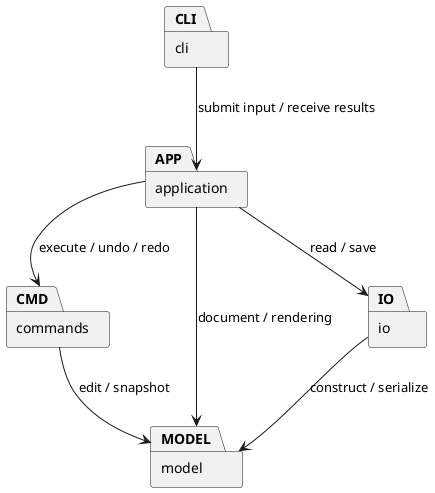

# Lab1 Phase 1：SVG 编辑器设计与开发记录

这次作业实现了一个通过命令行操作的 SVG 编辑器。我使用 TypeScript，在 AI 的协助下完成需求分析、架构设计、代码实现和测试。
开始时，我先根据[作业文档](phase_cli_1.md)整理[命令和验收要求](REQUIREMENTS.md)，再逐步完成图形模型、编辑命令、撤销重做、SVG 文件读写和命令行入口。开发过程中使用 Git 分步提交，保留各阶段的修改记录。
本阶段支持 `rect`、`circle`、`ellipse`、`line`、`text` 和 `g` 六种图形。

## 架构方案

### 1. 模块划分

我按照终端输入、应用协调、编辑操作、图形模型和文件读写这几个职责划分代码。每个模块负责一类事情，方便查找代码和后续修改。

| 目录 | 主要类或内容 | 职责 |
|---|---|---|
| `src/cli/` | `Main`、`Tokenizer` | 显示提示符，逐行读取输入，处理注释、双引号和参数分隔，输出执行结果 |
| `src/application/` | `Editor`、`Renderer` | 校验命令参数，协调编辑和文件操作，生成命令反馈、帮助、结构树和属性明细 |
| `src/commands/` | `Command`、`History`、各具体命令类 | 封装编辑操作，记录操作前后的状态，实现撤销和重做 |
| `src/model/` | `Shape`、六种图形类、`Document`、`ShapeFactory` | 保存图形状态，实现图形行为，维护文档树、唯一 id 和节点顺序 |
| `src/io/` | `SvgCodec`、`FileStore` | 解析和生成 SVG 文本，补全缺失 id，读取和保存文件 |
| `test/` | 各类测试文件 | 验证模型、命令、文件读写、命令行和架构约束 |
| `examples/` | 示例命令和 SVG | 保存可执行的命令示例和 SVG 示例 |
| `doc/` | 设计与验证文档 | 保存作业要求、架构说明、过程记录和检查结果 |
| `work/` | 本地测试文件和日志 | 保留测试生成的文件和运行记录 |

生产代码采用一类一文件，文件名与类名一致。下面的 PlantUML 包图表示业务模块之间的依赖关系：


### 2. 设计模式的选择与实现

#### 2.1 类层次、封装和多态

我用抽象类 `Shape` 定义图形共同具有的属性和行为。`Rect`、`Circle`、`Ellipse`、`Line`、`Text` 和 `Group` 继承它。
图形的 id、几何属性和样式保存在私有字段中，外部通过 `move`、`scale`、`set` 等方法修改状态。读取属性时返回冻结的副本，读取子节点时返回数组副本，避免外部直接修改内部集合。
不同图形的移动规则由各自的类实现：

- `Rect` 修改 `x`、`y`。
- `Circle` 和 `Ellipse` 修改 `cx`、`cy`。
- `Line` 同时修改两个端点。
- `Text` 修改文字位置。
- `Group` 调用各子节点的移动方法。

编辑命令统一调用 `shape.move(dx, dy)`，具体行为由对象的实际类型决定。这样可以通过多态处理不同图形。

#### 2.2 组合模式（Composite）

SVG 具有树形结构，因此我使用组合模式组织图形。
`Group` 继承 `Shape`，内部保存一组 `Shape` 子节点。子节点可以是普通图形，也可以是另一个 `Group`。
对容器执行 `move` 或 `scale` 时，操作递归传递给所有子孙。删除容器时，文档会移除整个子树。容器和普通图形都支持公共样式的 `set` 操作，`g` 的样式采用 SVG 的继承规则。几何属性的修改遵循各类型的白名单。
例如，下面的结构中包含一个嵌套容器：
```text
scene
├── rect1
└── nested
    └── text1
```
移动 `scene` 时，`rect1` 和嵌套的 `text1` 会一起移动。这种组织方式满足容器与叶子节点统一操作的要求，也能支持更深的嵌套结构。

#### 2.3 命令模式（Command）

作业要求使用命令模式。我为不同的编辑行为建立了具体命令类：

| 命令类 | 负责的操作 |
|---|---|
| `CreateCommand` | 创建图形 |
| `DeleteCommand` | 删除图形或子树 |
| `MoveCommand` | 移动 |
| `ScaleCommand` | 缩放 |
| `SetCommand` | 修改属性 |
| `GroupCommand` | 将已有图形加入新建容器 |
| `UngroupCommand` | 解散容器 |
| `AddToCommand` | 将图形移入已有容器 |
| `ReorderCommand` | 调整同级顺序，供 `front` 和 `back` 使用 |

这些类继承 `Command`。公共执行流程放在基类中，具体编辑逻辑放在各子类的 `apply` 方法中。`History` 保存已执行和已撤销的命令，管理 undo/redo。
以 `move r1 30 10` 为例，执行过程如下：
```text
Main 读取输入
    ↓
Tokenizer 拆分参数
    ↓
Editor 校验参数并创建 MoveCommand
    ↓
History 执行命令
    ↓
Command 创建文档副本
    ↓
MoveCommand 查找 r1，调用 Shape.move
    ↓
成功后更新当前文档并记录历史
    ↓
Main 输出结果
```
我选择让 CLI 负责输入，让 Command 表示一次可撤销操作，让图形类负责自身的变化。这也对应了我在讨论中提出的“统一接口、方便调用、方便 undo”的想法。
如果直接在 CLI 中修改 `r1.x`，终端层就需要了解矩形字段，并同时处理历史记录。当前设计让图形行为、编辑操作和终端输入分别由对应的对象承担。

#### 2.4 用快照支持撤销和重做

每条成功编辑命令保存操作前后的 `Document` 深拷贝，作为文档快照。撤销时恢复操作前的副本，重做时恢复操作后的副本。这种保存和恢复状态的方式借鉴了备忘录模式（Memento）的思路。
我选择快照方案，主要考虑到结构操作需要恢复的信息较多。例如，撤销 `group` 时，需要同时恢复多个图形的父容器和原有顺序。快照能够一起保存这些信息，也能避免通过反向浮点运算恢复坐标时产生误差。
历史管理遵循以下规则：

- 一条成功编辑命令对应一个 undo 单元。
- 撤销后执行新的成功编辑，清空 redo 分支。
- `tree`、`show`、`help` 和 `canvas` 查询保留现有历史。
- `init`、`read`、`save` 和修改尺寸的 `canvas` 成功后，清空历史并禁止撤销和重做。
- 此时执行 undo 或 redo，返回 `error: undo not allowed after io command`。
- 下一次成功编辑重新允许撤销和重做。
- 失败操作保持原有历史和撤销重做限制。

快照会占用额外内存。当前作业规模下，我优先选择容易验证、能够完整恢复状态的方案。大文档和长历史的性能优化留作后续改进。

#### 2.5 失败操作的处理

编辑命令先在文档副本上执行，全部成功后才更新当前文档和历史。
例如，容器缩放过程中，如果某个子节点计算出了无效数值，整条命令会失败，当前文档保持原值。
文档和文件操作按下面的顺序处理：

- `read` 完成读取、解析和验证后，再替换当前文档及默认保存路径。
- `canvas` 修改先在副本上验证尺寸。
- `save` 完成文件写入后，再更新撤销和重做限制。

命令失败后，当前文档、默认保存路径和 undo/redo 状态保持原值。文件写入过程中产生的临时文件按文件保留约定保存，供后续检查。
无参数 `save` 使用读入文件的路径；显式另存为其他文件后，该默认目标保持原值。`init` 新建的文档尚无读入路径，因此把首次成功显式保存的路径作为默认目标。这项补充规则记录在验收清单中。

#### 2.6 集中管理命令分派和图形创建

按照作业要求，按名称选择实现的逻辑集中在两处：
1. `Editor` 根据命令名选择处理逻辑。
2. `ShapeFactory` 根据图形类型创建具体对象。
CLI 创建图形和 SVG 读入共用 `ShapeFactory`，避免分别维护两套图形构造规则。
这两处是后续插件阶段的待重构项。增加插件时，可以围绕命令注册入口和图形工厂引入扩展机制，并接入 `ShapeProvider`。

### 3. 依赖方向规则

我规定各模块按照下面的方向依赖：

| 模块 | 允许依赖 | 原因 |
|---|---|---|
| `model` | 本模块 | 独立表达图形、树结构和 id 规则 |
| `commands` | 本模块、`model` | 编辑命令通过模型的行为接口修改文档 |
| `io` | 本模块、`model`、文件及 XML 库 | 集中处理文件格式与磁盘操作 |
| `application` | 本模块、`commands`、`model`、`io` | 协调当前文档、编辑、展示和存储 |
| `cli` | 本模块、`application`、Node 输入输出接口 | 通过应用层执行用户输入的操作 |
| `test` | 所有业务模块和测试工具 | 检查功能和模块约束 |

这套规则让核心图形模型可以独立测试。命令执行也可以在内存文档上验证，终端和磁盘操作分别由外围模块处理。
终端输入输出集中在 `cli`，SVG 解析和文件操作集中在 `io`。规则之外的依赖需要记录原因，并列入待处理项。

### 4. 对未来变化的考虑

| 可能发生的变化 | 当前准备 | 取舍 |
|---|---|---|
| 增加新图形，包括后续 `box` | 使用 `Shape` 类层次和集中工厂 | 当前完成六种内置类型，插件机制根据后续要求继续设计 |
| 增加编辑命令 | 每类编辑有独立 Command，Editor 提供集中注册入口 | 新命令可以复用历史管理 |
| 增加鼠标或 agent 输入 | 输入处理与 Editor、Command 分开 | 新输入方式可以调用已有应用逻辑 |
| 支持其他文件格式 | `SvgCodec` 和 `FileStore` 分开 | 当前只有 SVG，第二种格式出现后再提取公共接口 |
| 文档变大、历史变长 | 历史和文档操作集中管理 | 后续通过性能测量决定是否增加 id 索引、历史容量限制或差量记录 |
| 调整输出格式 | `Renderer` 集中生成 `tree` 和 `show` | 展示修改有明确位置 |

这些准备主要围绕当前需求展开。暂时没有实际使用场景的扩展接口，留到后续需求明确时再设计。

## 过程记录

本项目由我与 AI 协作完成。我主要提出需求、讨论设计、确认阶段范围，并在 GitHub Desktop 和 VS Code 中进行操作验证。AI 协助整理方案、实现代码、编写测试和分析结果。以下记录开发中几次对最终实现有影响的讨论和修改。

### 1. 理解统一接口与职责划分

讨论中，我首先关注统一图形接口与撤销重做之间的关系：不同图形可以通过共同接口执行移动等操作，那么操作的记录、撤销和重做应该由哪个模块负责？
进一步讨论后，我明确了各部分的职责：多态让不同图形响应相同的方法调用，Command 将一次编辑封装为独立操作，History 管理操作历史。
最终方案采用 `MoveCommand` 调用 `Shape.move`。各图形类实现自身的移动规则，Command 保存操作前后的状态，History 管理撤销和重做的顺序。

### 2. 根据原文确认阶段范围

核对作业要求时，文档中六种内置图形的参数表和 `box` 的完整说明需要结合阶段要求理解。经过重新阅读和讨论，我确认 Phase 1 实现 `rect`、`circle`、`ellipse`、`line`、`text` 和 `g`，`box` 留到后续插件阶段。当前执行 `create box` 应返回带插件提示的未知类型错误。
同时，我将几项特殊规则列入验收清单：根级 `g` 执行 `ungroup` 时应报错，成功保存后应限制 undo/redo，显示命令应保留操作历史。
对于跨父容器分组的位置、空历史时的反馈等原文未明确规定的情况，我在讨论后记录了具体处理方式，使实现与测试采用一致的规则。

### 3. 选择快照方式实现历史

讨论撤销方案时，分组、解散和删除容器是需要重点考虑的操作。它们涉及多个节点，撤销时需要同时恢复图形属性、父子关系和节点顺序。
此外，移动和缩放允许使用浮点数，通过反向计算恢复原值可能产生误差。综合这些情况，我选择保存操作前后的文档快照，用于撤销和重做。
实现先完成图形模型与容器操作，再加入 Command 和 History。协作测试检查了小数移动后的恢复、分组操作的一次撤销，以及失败编辑后继续 redo 等情况，验证了当前方案。
快照也有相应成本：每条命令保存前后文档，内存开销会随文档大小和历史长度增加。我将这一取舍记入架构方案，当前优先保证状态恢复完整，大文档性能留待后续优化。

### 4. 修正 SVG 转义和 XML 校验

检查 SVG 读写时，需要验证保存和读回后内容是否保持一致。测试因此覆盖了中文、引号、`&` 和首尾空格等情况。
协作测试发现属性序列化中的转义问题。结合输出结果讨论后，项目调整为由 `SvgCodec` 统一处理 SVG 输出转义。
另一项测试发现，不完整的 XML，例如 `<svg><rect`，可能被原先的解析流程接受。分析后确认，解析过程还需要检查文档是否正常结束，因此增加了 SAX 的完整结束校验和错误处理。
读取失败也应保持当前编辑状态。对应回归测试确认：解析失败后，当前文档、默认保存路径和 redo 分支保持原值。

### 5. 复查容器变换与分组参数

对照老师的嵌套 SVG 示例复查时，需要考虑将容器变换转换为坐标后，图形的显示效果能否保持一致。讨论和测试表明，缩放处理还需要同步考虑数值字号和线宽。
修订后，读入示例中的嵌套平移和缩放会更新相应坐标，并同步处理相关数值字号和线宽。CLI 的 `scale` 则按照命令细则，缩放各类图形的几何位置和尺寸。
同一轮核对还根据 `group <newGid> <id1> <id2>…` 的语法，明确命令至少接收两个成员。实现据此收紧参数数量，并增加失败后文档和历史保持原值的测试。

### 6. 在 VS Code 中进行操作验证

完成主要功能后，我在 VS Code 中通过实际命令检查程序行为，观察执行反馈和图形状态是否对应。
例如，移动容器后使用 `show` 检查子图形坐标；执行 undo 后检查坐标是否恢复，再执行 redo 检查移动结果是否重新出现。这组操作同时验证了容器递归移动和历史管理。
交互验证还覆盖了文字修改、缩放、删除恢复、保存和读回。保存后执行 undo 返回规定的 I/O 错误，创建 `box` 返回未知类型错误，结果与当前阶段要求对应。
操作过程中，我也确认了系统终端和编辑器命令行的区别：`npm` 等命令在系统终端执行，进入 `svg>` 后使用 `move`、`show`、`undo` 等编辑器命令。

### 7. 修正默认保存路径与反斜线处理

再次复查保存规则时，需要验证“显式另存后，无参数 save 应保存到哪里”。原文规定无参数 `save` 使用读入路径，而代码复查发现，旧实现会在显式另存后更新默认目标。
针对这一偏差，项目增加了回归场景：先读入 `source.svg`，再保存为 `copy.svg`，修改图形后执行无参数 `save`。修订后，最后的保存更新 `source.svg`，`copy.svg` 保留另存时的内容，行为与原文对应。
输入解析的复查还发现，旧实现会消耗双引号中的部分普通反斜线，影响路径和文本内容。修订后，普通反斜线通常按字面保留，同时支持双反斜线和引号的转义。
这两项修改均先通过新增用例复现旧行为，再运行回归测试确认修复结果。

### 8. 检查架构和保留开发历史

开发过程中，我持续对照架构方案核对模块职责；主要功能完成后，再检查实际目录和依赖关系是否与方案一致。
项目加入了 TypeScript 抽象语法树（AST）检查，验证生产代码的导入关系、类名、文件名和字段可见性。自动检查与源码抽样检查共同用于一致性自查，检查结果记录在对应文档中。
Git 提交按照模块实现和后续修订分步完成。我通过 GitHub Desktop 创建仓库并上传，再结合上传状态和远端页面核对提交及标签。更新最终版本时保留旧版备份标签，使开发过程和修订结果可以追溯。


## 一致性自查

### 1. 模块划分是否与方案一致

实际业务代码分为 `cli`、`application`、`commands`、`model` 和 `io` 五个目录，与架构方案一致。
`test`、`examples`、`doc` 和 `work` 分别保存测试、示例、文档和本地运行记录。`work` 中的本地生成文件按 `.gitignore` 规则保留在本机。
开发中的主要调整已经记入过程记录，包括 Main 入口的类封装、快照历史、SVG 解析与转义、导入属性保留、文件备份、变换处理和默认保存路径修正。
当前各模块的实际职责与前面的职责表对应。

### 2. 依赖方向是否符合规则

`Architecture.test.ts` 使用 TypeScript AST 检查全部生产代码中的导入关系，结果通过。
抽样检查包括：

| 检查对象 | 实际依赖与行为 | 对应规则 |
|---|---|---|
| `Main` | 调用 `Editor`，处理终端输入输出 | CLI 通过应用层执行操作 |
| `MoveCommand` | 使用 `Document` 查找图形，再调用图形行为 | commands 依赖 model |
| `Document` | 使用 `Shape` 和 `Group` 管理树结构 | model 内部协作 |
| `SvgCodec` | 使用模型和 XML 库完成转换 | io 负责格式转换 |
| `Editor` | 协调命令、模型、展示和文件服务 | application 负责应用协调 |

本轮检查范围内，没有发现违反既定模块依赖方向的导入。
后续待处理项主要是已在方案中说明的两处名称分派：命令注册和图形工厂需要在插件阶段继续重构。

## 质量保证手段

### 1. 按要求建立验证范围

我根据作业文档整理了验收清单，再让 AI 对照代码和测试检查实现情况。检查内容包括正常操作、错误输入、失败后的状态，以及撤销和重做的限制。

| 验证内容 | 主要检查方式 |
|---|---|
| 六种图形和多态行为 | 模型测试检查移动、缩放、属性修改和深拷贝 |
| 容器和树结构 | 检查嵌套移动、子树删除、分组、解散、归属及顺序 |
| Command 与历史 | 检查单命令撤销、重做、新编辑清 redo 和完整状态恢复 |
| 文档类操作 | 分别检查 init、read、save、canvas 修改后的 undo/redo 限制 |
| 失败状态保持 | 检查错误后文档、默认路径、redo 分支和撤销重做限制保持原值 |
| 命令参数与反馈 | 检查参数数量、数值范围、精确错误和成功摘要 |
| id 规则 | 检查唯一性、大小写敏感、缺失 id 补全和冲突避让 |
| SVG 读写 | 检查嵌套、中文、XML 转义、文本、表现属性及读写往返 |
| 文件保存 | 检查不可写文件、写入失败和覆盖前备份 |
| 实际 CLI | 启动程序进程，检查提示符、脚本输入、错误和 EOF |
| 架构 | 检查依赖方向、一类一文件、类名和字段封装 |
| 静态质量 | 运行 TypeScript 类型检查和 Prettier 格式检查 |

### 2. 运行老师给出的案例

项目中的 `Specification.test.ts` 直接从作业 Markdown 提取案例并执行，减少手动重新编写案例带来的遗漏。
最新复查还通过实际 CLI 入口重新运行了：

- 第 6 节完整典型会话，共 19 条命令。
- 第 6.1 节 A 版流程图，共 14 条命令。

命令反馈逐项核对通过。树形输出比较时归一化了用于对齐的连续空格；流程图连线允许额外显示 `stroke=black` 摘要。
保存结果也有对应检查：典型会话保存 5 个元素，流程图保存 8 个元素，并检查中文文本和撤销后的坐标。
第 6.1 节 B 版使用后续 `box` 插件，按阶段范围留到后续实现。

### 3. 当前验证结果

最近一次完整检查结果为：
```text
自动测试：94 项通过，0 项失败
TypeScript 类型检查：通过
Prettier 格式检查：通过
```
这些自动检查由 AI 协助执行。我的手动操作和终端截图补充验证了实际交互，保存的 SVG 也在浏览器中进行了预览。
详细检查记录见 [AUDIT.md](AUDIT.md)、[REVIEW.md](REVIEW.md) 和 [VERIFICATION.md](VERIFICATION.md)。历史记录保留当时的测试数量，最新全量结果为 94 项。
测试结果说明已覆盖场景符合预期。我同时结合原文核对、源码检查和实际运行结果判断完成情况。

### 4. 运行方法

项目使用 Node.js 24 及以上版本直接执行 TypeScript。安装依赖后，可在项目目录运行：
```sh
npm install
npm run check
npm run format:check
npm test
npm run cli
```
进入 `svg>` 后，可以执行：
```text
init 400 200
create g scene
create rect r1 10 20 100 50 #4a90d9 in scene
move scene 30 10
show r1
undo
show r1
redo
show r1
```
这组命令可以观察容器移动、矩形坐标变化以及撤销重做。结束命令行编辑器使用 EOF，macOS 终端中可在空输入行按 `Control+D`。
更完整的操作步骤见 [RUNNING.md](RUNNING.md)。

### 5. 当前范围与后续改进

当前 SVG 读写覆盖本阶段六种图形、嵌套 `g`、数值几何属性、XML 转义，以及老师示例中的平移和正数等比缩放。
根宽高缺省为 800×600，`viewBox` 支持与画布一致的 `0 0 w h`。复杂 CSS、路径图形、旋转、矩阵和任意坐标映射留作后续扩展。遇到未知图形或当前范围之外的变换时，程序返回错误。
后续可以继续改进的部分包括：

- 实现图形和命令插件机制，接入 `box`。
- 为大文档增加 id 索引，减少重复遍历。
- 根据测量结果优化快照成本和历史容量。
- 在现有 Editor 和 Command 上增加其他输入方式。
- 根据新增格式的实际需求提取公共读写接口。
